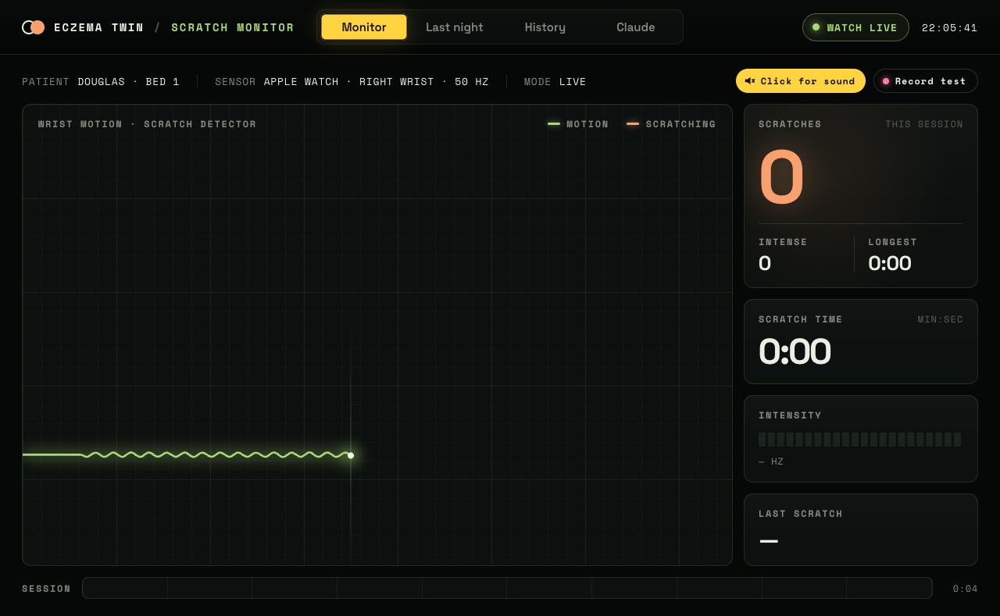
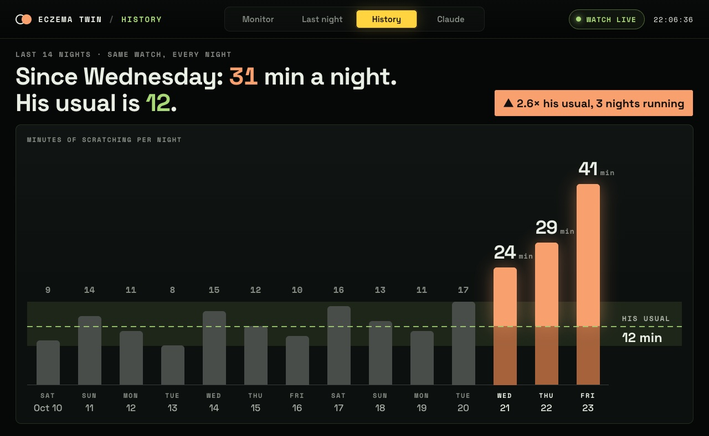

# SkinXAI

**Making skin great again.** Everything for SkinXAI in one repo (Cal Hacks 13.0):

| Folder | What |
|---|---|
| [`app/`](app/) | iPhone + Apple Watch app (SwiftUI, watchOS): scratch detection, Summary, Trends, Claude Insight. See [app/README.md](app/README.md). Includes the Capital One Nessie integration in `app/Integrations/nessie`. |
| `worker/`, `web/` | Server (Cloudflare Worker + Durable Object): live watch relay, Claude endpoint, Nessie `/api/orders`, and the big-screen web view. |

---

# SkinXAI Live (server)

**Making skin great again.** Server and big-screen web view for [SkinXAI](https://github.com/Jacky040124/skinxai-app): your Apple Watch notices when you scratch in your sleep, and Claude finds what is making your eczema flare.

Built at **Cal Hacks 13.0** (October 2026).

Live: https://eczema-twin-live.zhongzhenyu190.workers.dev

| Live scratch monitor | Scratching history |
|---|---|
|  |  |

## What's in here

- **Live relay** (Cloudflare Worker + Durable Object): the Apple Watch posts its motion data and detected scratch episodes; the phone and the web view receive them in real time over WebSockets.
- **Claude endpoint** (`POST /api/chat`): adds the instructions and the tool list and asks Claude Opus 5.5 (through OpenRouter) for its next turn. The client runs the tools and sends the conversation back.
- **Web view** (`web/`): a bedside-monitor style big screen for demos, with four pages: Monitor (live wrist motion and scratch detection), Last night, History, and Claude.

## API

| Route | What it does |
|---|---|
| `POST /api/ingest` | Watch sends motion samples and episodes (needs the key) |
| `GET /api/live` | WebSocket stream for the phone and the web view |
| `GET /api/events`, `/api/status` | Recent episodes, connection status |
| `POST /api/chat` | One Claude turn with tools |
| `POST /api/analyze` | One-shot analysis of a nightly log |
| `POST /api/reset` | Clears the live session (needs the key) |

## Run it

```bash
npm install -g wrangler
wrangler secret put OPENROUTER_KEY
wrangler secret put INGEST_KEY   # the watch uses this to post data
wrangler dev        # local
wrangler deploy     # Cloudflare
```

## What is real and what is demo data

The watch data and Claude's calls are live. The purchases, weather, calendar and sleep history are a scripted story for one person (Douglas), because weeks of real data can't be collected during a hackathon.

## Team

Jacky Zhong and Douglas Chen (University of British Columbia).
